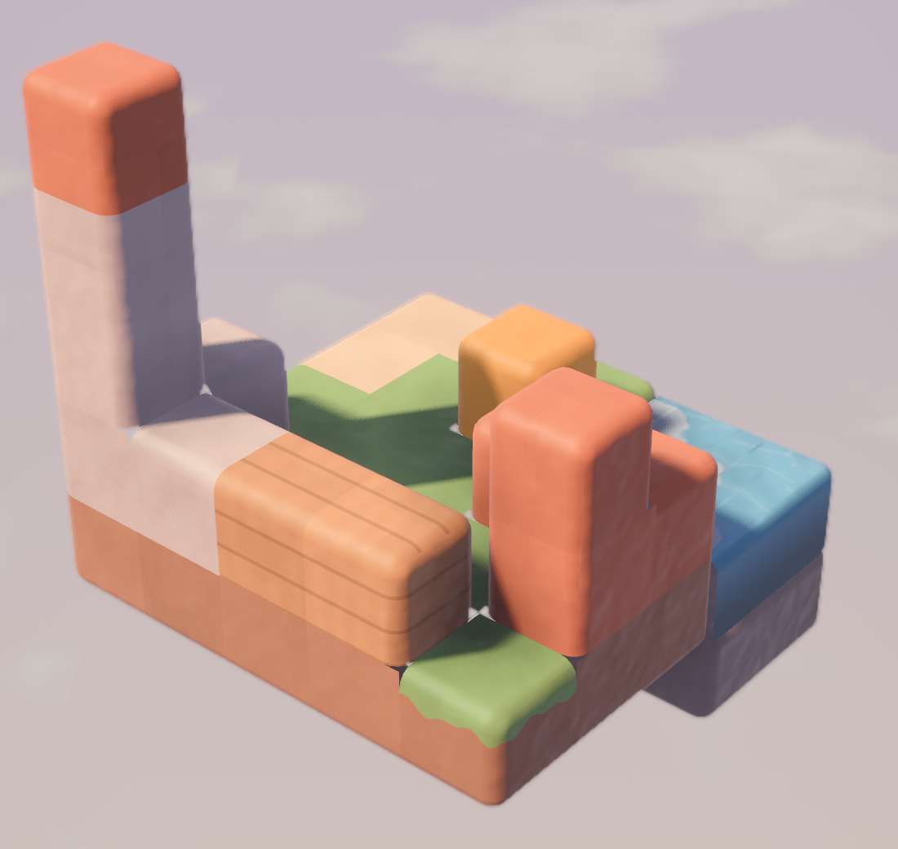

# Tiny Courier

A calm 3D diorama puzzle game for Android, built with Godot 4 (GDScript).
A little walking mailbox delivers parcels across small floating clay
dioramas: drag to rotate the diorama, tap a spot to walk there, and operate
the orange mechanisms to open a path.

> **Status:** early development (build steps 1–3 of 10 done: lighting and sky,
> clay block meshing, orbit camera with tap picking).



## Art direction

The game should never be mistaken for an existing block-puzzle game, so it
deliberately avoids the crisp bevelled-cube grid and a one-eyed robot hero:

- **Soft clay diorama.** Neighbouring blocks merge into one sculpted lump with
  big rounded outside edges, wrap lighting with a warm glow at the shadow
  line, a soft sheen, hand-pressed colour mottling and shallow thumb dents.
- **Dusk sky with a sea of clouds** below the diorama, turning with the camera.
- **The courier is a walking mailbox**: its flag pops up when it carries a
  parcel, and its door flap opens to drop it on the pad.

Clay was picked over a storybook-ink look and a natural-rock look; see
`docs/screenshots/look_comparison.png` (clay, storybook, isles).

## Requirements

- Godot **4.7** or newer (standard build, no .NET needed).
- Renderer: Mobile (Vulkan), with automatic fallback to Compatibility.

## Running

Open the folder in Godot and press **Play**, or from a terminal:

```bash
godot --path .
```

## Controls

| Gesture | Action |
| --- | --- |
| One-finger drag | Orbit the diorama (pitch 15°–70°), with inertia when flicked |
| Pinch (mouse wheel on desktop) | Zoom, 0.7×–1.4× |
| Tap | Pick the block face under the finger (moves of under 12 px still count as taps) |
| Double-tap empty space | Ease back to the default view |

The camera (`camera/OrbitCamera.gd`) fits its distance so the diorama fills
75% of the shorter screen axis from every yaw. Taps are resolved with a voxel
raycast against the grid (`core/Grid.gd`), so no physics bodies are needed.

## Tests

`tools/test_orbit_camera.gd` drives the test diorama with synthetic touch
events and checks tap vs drag, inertia, pitch limits, pinch zoom, double-tap
reset, picking and the fit (needs a renderer, exits non-zero on failure):

```bash
godot --path . --resolution 405x720 -s res://tools/test_orbit_camera.gd -- --out=docs/screenshots
```

## Screenshots from the command line

`tools/capture.gd` renders a scene for a number of frames and saves a PNG:

```bash
godot --path . --resolution 720x1280 -s res://tools/capture.gd -- --scene=res://dev/test_diorama.tscn --out=docs/screenshots/step1.png --frames=90
```

Add `--size=720x1280` to render offscreen at an exact size (useful when the
desktop is smaller than the capture), and `--crop=X,Y,W,H` to save only a
region for close-ups. The tool also prints draw calls and triangle counts.

## Blocks

`render/BlockMesher.gd` turns a level's cells (`Vector3i -> block type`) into
one mesh with a surface per material:

- faces touching another solid block are culled and neighbours merge into
  one smooth surface;
- only the outside edges of the combined shape are rounded (0.17 m radius,
  four segments per edge);
- voxel ambient occlusion, a lighter top / darker bottom tint and a small
  per-block colour jitter (which keeps cells faintly readable) are baked into
  vertex colours;
- water is lowered slightly, merges with neighbouring water and gets its own
  animated shader.

Block types: `stone`, `dark_stone`, `sand`, `grass` (dirt sides with a grass
lip), `wood` (plank lines), `brick`, `water`, and `accent` for interactive
parts (pulsing orange). Colours live in `render/Palette.gd`, materials in
`render/BlockMaterials.gd`, the clay surface in `shaders/block.gdshader` with
shared helpers in `shaders/block_common.gdshaderinc`.

## Project layout

```
autoload/   global singletons (game state, audio, saving)
core/       grid, pathfinding, level loading, undo
render/     palette, stage lighting, procedural meshes
shaders/    block, water, sky and effect shaders
entities/   courier, packages, mechanisms
camera/     orbit camera
ui/         menus and HUD
levels/     level JSON, one folder per world
tools/      dev and validation scripts
dev/        test scenes used during development
```

All art is generated procedurally in code; there are no external model or
texture files.
