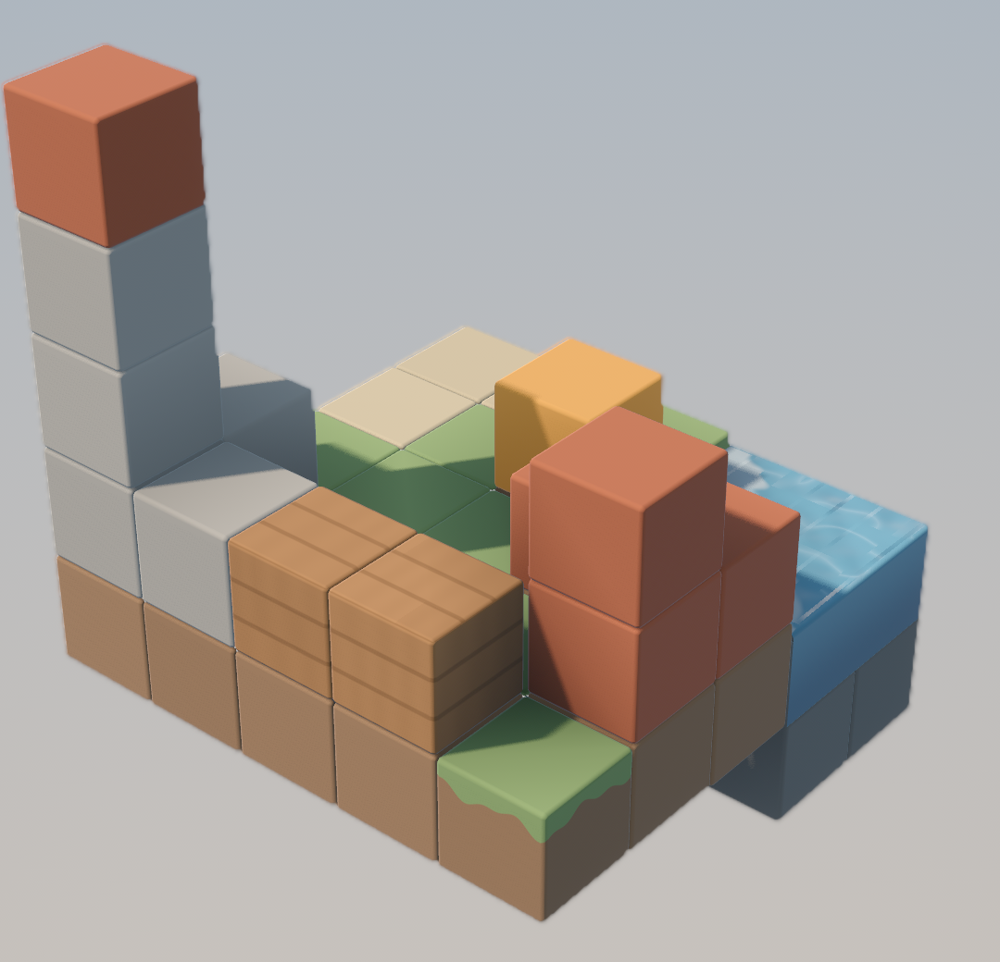

# Tiny Courier

A calm 3D diorama puzzle game for Android, built with Godot 4 (GDScript).
A tiny courier robot delivers packages across small floating block dioramas:
drag to rotate the diorama, tap a block to walk there, and operate the orange
mechanisms to open a path.

> **Status:** early development (build step 2 of 10: procedural block meshing
> with bevels, face culling and baked ambient occlusion).



## Requirements

- Godot **4.7** or newer (standard build, no .NET needed).
- Renderer: Mobile (Vulkan), with automatic fallback to Compatibility.

## Running

Open the folder in Godot and press **Play**, or from a terminal:

```bash
godot --path .
```

## Screenshots from the command line

`tools/capture.gd` renders a scene for a number of frames and saves a PNG:

```bash
godot --path . --resolution 720x1280 -s res://tools/capture.gd -- --scene=res://dev/test_diorama.tscn --out=docs/screenshots/step1.png --frames=90
```

Add `--size=720x1280` to render offscreen at an exact size (useful when the
desktop is smaller than the capture), and `--crop=X,Y,W,H` to save only a
region for close-ups. The tool also prints draw calls and triangle counts.

## Blocks

`render/BlockMesher.gd` turns a level's cells (`Vector3i -> block type`) into
one mesh with a surface per material:

- every block is a cube with rounded edges (0.04 m, two segments);
- faces touching another solid block are culled, while the bevels between
  neighbours stay as a shallow groove so the grid reads clearly;
- voxel ambient occlusion, a lighter top / darker bottom tint and a small
  per-block colour jitter are baked into vertex colours;
- water is lowered slightly, merges seamlessly with neighbouring water and
  gets its own animated shader.

Block types: `stone`, `dark_stone`, `sand`, `grass` (dirt sides with a grass
lip), `wood` (plank lines), `brick`, `water`, and `accent` for interactive
parts (pulsing orange). Colours live in `render/Palette.gd`, materials in
`render/BlockMaterials.gd`.

## Project layout

```
autoload/   global singletons (game state, audio, saving)
core/       grid, pathfinding, level loading, undo
render/     palette, stage lighting, procedural meshes
shaders/    block, water, sky and effect shaders
entities/   courier, packages, mechanisms
camera/     orbit camera
ui/         menus and HUD
levels/     level JSON, one folder per world
tools/      dev and validation scripts
dev/        test scenes used during development
```

All art is generated procedurally in code; there are no external model or
texture files.
