# Tiny Courier

A calm 3D diorama puzzle game for Android, built with Godot 4 (GDScript).
A little walking mailbox delivers parcels across small floating clay
dioramas: drag to rotate the diorama, tap a spot to walk there, and operate
the orange mechanisms to open a path.

> **Status:** version 1.0.0, all ten build steps done: lighting and sky,
> clay block meshing, orbit camera with tap picking, the courier with
> pathfinding, playable levels from JSON with parcels, pads and an exit,
> mechanisms (sliders, elevators, buttons, conveyors, rotators and gates),
> undo, restart, hints, stars and saved progress, 50 solver-checked levels
> in five worlds (the last two seasonal), the menus, settings, generated
> sound and music, haptics and the build-up animations, and the graphics
> quality presets and the Android build, plus calm ads from world 2 on (see
> [Ads](#ads)). The APK has been run on an emulator; frame rate and memory
> still need checking on real phones (see
> [Performance and quality](#performance-and-quality)).

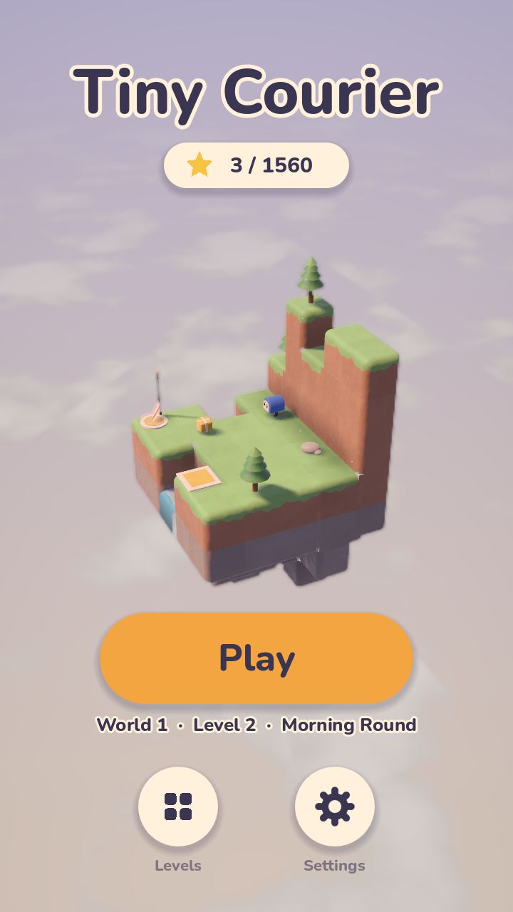 

## How a level plays

Each level is a floating clay diorama. The courier walks to wherever you
tap, picks up a parcel by walking onto it (one at a time in worlds 1–2, two
from world 3), and drops it automatically on the pad of the same colour. Once
every pad is filled the exit's pennant runs up its post; walking onto the
exit finishes the level. Every cell walked is a move, and each level sets
three move limits for three, two and one star.

The orange parts move (see [Mechanisms](#mechanisms)): drag a slider, tap a
crank to turn a bridge, step on an elevator to ride it or on a button to
switch something. Dragging a slider or turning a crank costs one move;
riding a belt or an elevator costs nothing.

Worlds 4 and 5 bring in the seasons, each with a ground of its own:

- **Dry boards** (autumn): plank decks on beams that shake, tip and drop
  away once the courier steps off them, so each plank bridge can be crossed
  once. Plan the trips before setting out.
- **Ice** (winter): a step onto ice slides the courier on in the same
  direction until the next cell is not open ground at its level (a rock, a
  snowman, an edge, a closed gate, stairs) or it slides off onto snow, where
  it stops. A whole slide is one move, and a belt stops it.

The rules live in `core/LevelState.gd`, with no visuals, so the solver and
undo can reuse them; `game/Level.gd` builds the scene and animates them:
the mailbox flaps its door to swallow a parcel and raises its flag in the
parcel's colour, flaps it again to pop the parcel out onto the pad, and the
pad lights up with a burst of sparkles.

The HUD shows the level's name, the moves so far and a star meter (the stars
you would earn by finishing now, and the move count that keeps them), with
Restart, Undo and Hint buttons at the bottom and Pause at the top left.
Finishing brings up a card with the stars earned, the best so far, the
limits, and Replay / Next / Levels. See
[Undo, hints, stars and saving](#undo-hints-stars-and-saving) and
[Menus](#menus).

## Art direction

The game should never be mistaken for an existing block-puzzle game, so it
deliberately avoids the crisp bevelled-cube grid and a one-eyed robot hero:

- **Soft clay diorama.** Neighbouring blocks merge into one sculpted lump with
  big rounded outside edges, wrap lighting with a warm glow at the shadow
  line, a soft sheen, hand-pressed colour mottling and shallow thumb dents.
- **Dusk sky with a sea of clouds** below the diorama, turning with the camera.
- **The courier is a walking mailbox**: its flag pops up when it carries a
  parcel, and its door flap opens to drop it on the pad.

Clay was picked over a storybook-ink look and a natural-rock look; see
`docs/screenshots/look_comparison.png` (clay, storybook, isles).

 

## The courier

`entities/Courier.gd` walks cell to cell (0.28 s per cell) and animates
procedurally: breathing while idle, a waddle with swinging legs and a forward
lean, a squash when it lands, a puzzled head tilt, a happy hop-and-spin with
"^ ^" eyes, and the odd blink. `render/CourierBuilder.gd` builds it from clay
parts made by `render/ClayShapes.gd` (rounded extrusions), with a soft blob
shadow under its feet.

Movement rules (`core/Pathfinder.gd`, an AStar3D graph over the grid):

- the courier stands in an empty cell on top of a block with a walkable top
  (anything but water and stairs);
- it steps one cell at a time to a horizontal neighbour at the same height,
  never jumping gaps or dropping down;
- the only way up or down is stairs: a stairs block links the cell at its
  foot with the cell past its top, one level higher;
- a step onto ice links straight to where the slide ends, so routes over ice
  are found the same way (the courier wobbles as it glides).

Tapping a block walks to the cell on top of it (or onto stairs). A white
ripple marks the destination; a red ripple and a puzzled tilt mean there is
no way there. A new tap mid-walk re-routes after the current step.

## Requirements

- Godot **4.7** or newer (standard build, no .NET needed).
- Renderer: Mobile (Vulkan), with automatic fallback to Compatibility.

## Running

Open the folder in Godot and press **Play**, or from a terminal:

```bash
godot --path .
```

The main scene, `ui/Menu.tscn`, opens on the splash and then the main menu;
Play opens the next level to play (picking up a game in progress). To try
one level straight away, open `game/Level.tscn`, set its `level_path` and
press **F6**.

## Building

The game itself plays offline, with everything it needs in the project. The
network is used only by the ads (Google AdMob, from world 2 on; see
[Ads](#ads)), whose libraries Gradle downloads when the Android build runs.

### Android

The Android preset is checked in (`export_presets.cfg`): package
`com.manpreetgugga.tinycourier`, version 1.0.0 (code 1), 64-bit ARM only,
full screen, portrait, with the permissions VIBRATE, INTERNET,
ACCESS_NETWORK_STATE and AD_ID (the last three for the ads; Google's ads
SDK merges in a few of its own, such as the Privacy Sandbox's
ACCESS_ADSERVICES_* and WAKE_LOCK). It uses Godot's Gradle build, which
the ads plugin needs. Once per machine:

1. Install the export templates for your Godot version (**Editor → Manage
   Export Templates**), then the Android build template into the project
   (**Project → Install Android Build Template**). The template lands in
   `android/`, which is not checked in.
2. Install the Android SDK (with build-tools and platform-tools; Android
   Studio does this) and a JDK **17 to 23**: Gradle 8.11, which the
   template uses, doesn't run on Java 24 or newer, and the newest Android
   Studio ships Java 25 in its `jbr` folder. A JDK 21 is a safe choice.
3. In **Editor → Editor Settings → Export → Android**, set **Java SDK Path**
   (to that JDK) and **Android SDK Path**. Godot reads them from there only,
   not from `JAVA_HOME`. It makes a debug keystore by itself.

Then build a debug APK (about 50 MB) and install it on a phone with USB
debugging on (the first build downloads Gradle and the libraries, which
takes a few minutes):

```bash
godot --headless --path . --export-debug "Android" export/TinyCourier-debug.apk
adb install -r export/TinyCourier-debug.apk
```

A release build must be signed with your own upload key: Google Play signs
the published game with its own key (Play App Signing), and the upload key
proves each upload is yours. It was made once, with `keytool` (it comes
with the JDK), as `~/keys/tinycourier.jks` with the alias `tinycourier`,
valid until 2054. Keep it and its password out of the repository
(`.gitignore` skips `*.jks` too), and back both up: every update must be
signed with the same key, and replacing a lost one takes a request to
Google.

```bash
keytool -genkeypair -v -keystore ~/keys/tinycourier.jks -alias tinycourier -keyalg RSA -keysize 2048 -validity 10000
```

Godot finds the key through the environment rather than the preset, so
nothing secret is committed. The password is read without echoing it, so it
stays out of the shell's history. In PowerShell:

```powershell
$env:GODOT_ANDROID_KEYSTORE_RELEASE_PATH = "$HOME\keys\tinycourier.jks"
$env:GODOT_ANDROID_KEYSTORE_RELEASE_USER = "tinycourier"
$env:GODOT_ANDROID_KEYSTORE_RELEASE_PASSWORD = [Net.NetworkCredential]::new("", (Read-Host -AsSecureString "Keystore password")).Password
godot --headless --path . --export-release "Android" export/TinyCourier.apk
```

or in bash:

```bash
export GODOT_ANDROID_KEYSTORE_RELEASE_PATH=~/keys/tinycourier.jks
export GODOT_ANDROID_KEYSTORE_RELEASE_USER=tinycourier
read -rsp "Keystore password: " GODOT_ANDROID_KEYSTORE_RELEASE_PASSWORD; echo; export GODOT_ANDROID_KEYSTORE_RELEASE_PASSWORD
godot --headless --path . --export-release "Android" export/TinyCourier.apk
```

The variables last only as long as that terminal.

A release build shows Google's test ads until the game is live on Google
Play; see [Ads](#ads) for switching to its own.

Google Play wants an Android App Bundle (`.aab`) rather than an APK: set the
preset's export format to AAB. Play also lists the game only for phones
with Vulkan; the game itself falls back to OpenGL where Vulkan is missing.

### Other platforms

Add a preset under **Project → Export** and export, for example:

```bash
godot --headless --path . --export-release "Windows Desktop" export/TinyCourier.exe
```

The levels are plain `.json` files, so every preset must include them: set
**Resources → Filters to export non-resource files** to `*.json` (the
Android preset does). It also leaves out `dev/`, `tools/` and the icon
layers that only the Android launcher uses.

### Icons and sounds

The app icon is rendered from the game: `tools/make_icon.gd` stands the
courier, flag up, on a small grass island (`dev/icon_level.json`) and writes
`icons/icon.png` plus the layers of Android's adaptive icon (a foreground
kept inside the part every launcher shows, the sky behind it, and a white
silhouette for Android 13's themed icons). It needs a renderer:

```bash
godot --path . -s res://tools/make_icon.gd
```

The sounds are generated, not recorded. They are checked in, so building
needs nothing extra. After changing `tools/make_audio.gd`, render them again:

```bash
godot --headless --path . -s res://tools/make_audio.gd
```

## Controls

| Gesture | Action |
| --- | --- |
| One-finger drag | Orbit the diorama (pitch 15°–70°), with inertia when flicked |
| Pinch (mouse wheel on desktop) | Zoom, 0.7×–1.4× |
| Tap | Walk to the spot under the finger (moves of under 12 px still count as taps) |
| Drag a slider | Slide it along its track; it follows the finger, stops at anything in its way and snaps to the nearest cell when let go |
| Tap a crank | Turn its rotator a quarter turn |
| Double-tap empty space | Ease back to the default view |
| Undo button (Z or Backspace on desktop) | Take back the last walk, slider drag, crank turn or restart |
| Restart button (R) | Start the level again |
| Hint button (H) | Show the next step of the shortest way to finish |
| Pause button (Esc or P) | Pause: resume, restart, settings, the level grid or the main menu |
| Android back button (Esc) | Close the open card, then back one screen; in a level it pauses |

A drag that starts on a slider moves the slider instead of the camera, and
input waits while mechanisms move. A level pauses itself when the app goes
to the background.

The camera (`camera/OrbitCamera.gd`) fits its distance so the diorama fills
75% of the shorter screen axis from every yaw. Taps are resolved with a voxel
raycast against the grid (`core/Grid.gd`), so no physics bodies are needed.

## Tests

The test scripts need a renderer (not `--headless`), print PASS/FAIL per
check and exit non-zero on any failure. They save to
`user://test_progress.json` and `user://test_settings.json`, leaving the
player's own save and settings alone. The camera and courier tests play
`dev/sandbox_level.json`. Add `--audio-driver Dummy` to run them silently.

`tools/test_orbit_camera.gd` drives the sandbox with synthetic touch events
and checks tap vs drag, inertia, pitch limits, pinch zoom, double-tap reset,
picking and the fit:

```bash
godot --path . --resolution 405x720 -s res://tools/test_orbit_camera.gd -- --out=docs/screenshots
```

`tools/test_courier.gd` checks walkability and stairs in the pathfinder, then
taps through the real input path: climbing to the walkway, an unreachable
tap, re-routing mid-walk and walking back down. It also saves close-up
portraits of the courier:

```bash
godot --path . --resolution 405x720 -s res://tools/test_courier.gd -- --out=docs/screenshots
```

`tools/test_level.gd` checks the loader's error reports and the delivery
rules (including undo snapshots), then plays world 1 level 1 by tapping and
expects the minimum of 11 moves for three stars:

```bash
godot --path . --resolution 405x720 -s res://tools/test_level.gd -- --out=docs/screenshots
```

`tools/test_mechanisms.gd` checks the loader's mechanism errors, then plays
one small level per mechanism from `dev/mechanisms/` through the real touch
path: dragging a slider into a gap, riding an elevator up, calling it down
with a button, a one-way belt whose ridden cells cost nothing, turning a
bridge with a crank, a gate that needs both of its buttons, a slide over ice
that stops at a rock, and dry boards that drop away once crossed. It saves a
`step6_*.png` screenshot of each mechanism and `seasons_ice.png` and
`seasons_boards.png`:

```bash
godot --path . --resolution 405x720 -s res://tools/test_mechanisms.gd -- --out=docs/screenshots
```

`tools/test_progress.gd` checks that the solver's shortest finish is the
three-star limit of the mechanism test levels and level 1, the save file (bests, a corrupt file, a game
in progress coming back exactly, a stale or broken one being ignored), undo
and restart (including undo the moment a parcel drops), the HUD buttons
through the touch path, resuming a closed level with its undo history, and
then finishes those levels by following hints alone, expecting three stars.
It saves `step7_*.png` screenshots:

```bash
godot --path . --resolution 405x720 -s res://tools/test_progress.gd -- --out=docs/screenshots
```

`tools/test_levels.gd` plays the whole catalogue: for each of the 50 levels
it checks that the solver's fewest moves is the three-star limit, that a
hint from the start stays within the search budget and that the plan
finishes the level by the rules; then it opens the level and follows the
hints alone through the touch path (taps, slider drags, crank taps), turning
the camera a quarter when something hides the next tap, until the level is
finished with three stars. It runs the game at triple speed (under two
minutes in all) and saves `step8_levels.png`, a contact sheet of every level
as it starts. Pass level paths to play only those (no contact sheet):

```bash
godot --path . --resolution 405x720 -s res://tools/test_levels.gd -- --out=docs/screenshots
godot --path . --resolution 405x720 -s res://tools/test_levels.gd -- res://levels/world_2/level_3.json
```

`tools/test_ui.gd` checks level unlocking, the settings file (defaults, a
broken file, every setting surviving a reload), haptic ticks and their
switch, then drives the menus through the touch path: splash, main menu,
world select, a locked world and level, the level grid, back navigation and
the settings card (sliders, toggles, quality, the render size each quality
gives a phone, and the performance readout). It plays a level through the
same path: the build-up, the sounds and haptics of a walk and a delivery,
pausing and resuming, the confetti, the
tear-down and back to the level grid, with a simulated notch to check the
safe area. It saves `step9_*.png` screenshots:

```bash
godot --audio-driver Dummy --path . --resolution 405x720 -s res://tools/test_ui.gd -- --out=docs/screenshots
```

`tools/test_ads.gd` checks where and when ads may show, with `Ads.Preview`
standing in for AdMob: the switch, world 1 without ads, the hint video
offer (Not now, back, a video closed early, one watched to the end), the
level breaks (only as the finish card is left by Next or back, every 3 or 4
levels, never on Replay, after a restart, after a finish with no star or
within 4 minutes of another ad), the count surviving a restart of the game,
no pause card under an ad, and the Ad privacy row in Settings. The other
tests turn the ads off. It saves `ads_*.png` screenshots:

```bash
godot --audio-driver Dummy --path . --resolution 405x720 -s res://tools/test_ads.gd -- --out=docs/screenshots
```

`tools/benchmark.gd` measures the quality presets; see
[Performance and quality](#performance-and-quality).

## Screenshots from the command line

`tools/capture.gd` renders a scene for a number of frames and saves a PNG:

```bash
godot --path . --resolution 720x1280 -s res://tools/capture.gd -- --scene=res://game/Level.tscn --out=docs/screenshots/level.png --frames=90
```

Add `--size=720x1280` to render offscreen at an exact size (useful when the
desktop is smaller than the capture), and `--crop=X,Y,W,H` to save only a
region for close-ups. The tool also prints draw calls and triangle counts.

## Blocks

`render/BlockMesher.gd` turns a level's cells (`Vector3i -> block type`) into
one mesh with a surface per material:

- faces touching another solid block are culled and neighbours merge into
  one smooth surface;
- only the outside edges of the combined shape are rounded (0.17 m radius,
  four segments per edge);
- voxel ambient occlusion, a lighter top / darker bottom tint and a small
  per-block colour jitter (which keeps cells faintly readable) are baked into
  vertex colours;
- water is lowered slightly, merges with neighbouring water and gets its own
  animated shader.

Block types: `stone`, `dark_stone`, `sand`, `grass` (dirt sides with a grass
lip), `dirt`, `wood` (plank lines), `brick`, `water`, `accent` for interactive parts
(pulsing orange), and `stairs`, which has its own clay mesh and a facing (the
direction it climbs). The seasons add `autumn_grass` (an amber lip), `snow`
(a snow cap over slate), `slate`, `ice` (a pale glaze with frost streaks) and
`boards`, dry boards drawn by `entities/DryBoards.gd` as a plank deck on
beams that drops onto whatever is below when it falls. Colours live in `render/Palette.gd`, materials in
`render/BlockMaterials.gd`, the clay surface in `shaders/block.gdshader` with
the shared clay lighting in `shaders/clay_common.gdshaderinc`.

## Levels

Levels are JSON files in `levels/world_<n>/level_<n>.json`. Coordinates are
whole cells; `y` is up. `start`, `exit` and the positions of parcels and pads
are *standing* cells: the empty cell the courier occupies, directly above the
block it stands on.

```json
{
	"name": "First Delivery",
	"world": 1,
	"palette": "meadow",
	"blocks": [[0, 0, 0, "grass"], [1, 0, 0, "sand"], [2, 1, 1, "stairs", "+x"]],
	"props": [[0, 1, 0, "tree_small", 0, true], [3, 1, 3, "fence", 90]],
	"mechanisms": [],
	"packages": [{ "pos": [2, 1, 3], "color": "red" }],
	"pads": [{ "pos": [5, 2, 1], "color": "red" }],
	"start": [0, 1, 3],
	"exit": [4, 2, 0],
	"stars": [11, 14, 18]
}
```

| Key | Meaning |
| --- | --- |
| `name`, `world` | Title, and the world (1–5) it belongs to. |
| `palette` | Sky and light theme: `meadow`, `harbor`, `old_town`, `orchard` (autumn) or `frost_peaks` (winter). A seasonal palette recolours trees and bushes (amber leaves, snowy boughs) and adds falling leaves or snow (`render/Weather.gd`). |
| `blocks` | `[x, y, z, type]`. Types: `stone`, `dark_stone`, `sand`, `grass`, `dirt`, `wood`, `brick`, `water`, `accent`, `autumn_grass`, `snow`, `slate`, `ice`, `boards`. Stairs are `[x, y, z, "stairs", facing]`, climbing towards `facing` (`+x`, `-x`, `+z`, `-z`); `stairs_stone`, `stairs_wood` and `stairs_brick` change the material. Parcels, pads, the exit and buttons may not stand on ice or boards (the start may be on ice). |
| `props` | Decor, `[x, y, z, type, rotation?, solid?]`: `tree_small`, `tree_tall`, `bush`, `lamp_post`, `flag`, `crate`, `fence`, `rock`, `pumpkin`, `leaf_pile`, `snowman`. Rotation is in degrees about up; fences run along the cell's −z edge before rotation. Props are walk-through unless `solid` is `true`. |
| `mechanisms` | Optional moving parts; see [Mechanisms](#mechanisms). |
| `packages`, `pads` | `{ "pos": [x, y, z], "color": ... }` with colours `red`, `green`, `blue`, `yellow`. Each parcel needs exactly one pad of its colour. |
| `start`, `exit` | Where the courier begins and where it finishes. |
| `stars` | Move limits for three, two and one star, not decreasing. |
| `carry` | Optional: parcels carried at once (default 1, or 2 from world 3). |

To add a level, write the file, set `game/Level.tscn`'s `level_path` to it
and press F6. `core/LevelLoader.gd` checks the level as it loads and prints
every problem with where it is (for example `packages[0]: (2, 0, 3) is not
a cell the courier can stand in`), and the level will not start until they
are fixed. `dev/sandbox_level.json` is a small test level used by the tests.

The menus find levels by their file names, so a new `level_<n>.json` shows
up in its world's grid on its own (and a new `world_<n>` folder as a new
world; give it a name in `core/LevelCatalog.gd`'s `WORLD_NAMES`). Check it
and set its stars with `tools/check_levels.gd --fix-stars`.

### The 50 levels

`core/LevelCatalog.gd` finds the levels by their file names, worlds by
number and then levels by number (gaps are allowed, other files are
ignored), so a new file in a world folder is part of the game; Next on the
finish card follows this order. Each world brings in something new:

| World | Palette | Carry | Levels |
| --- | --- | --- | --- |
| 1 | `meadow` | 1 | Walking, stairs and water, then sliders: a sliding bridge, a raft, two rafts on one channel and two crossing sliders. |
| 2 | `harbor` | 1 | Elevators, a button that calls a lift, gates opened by one button or two, belts, belts switched on and off, and all of them together. |
| 3 | `old_town` | 2 | Two parcels at once, turntables (one carrying a parcel across, one shaped like a cross, two that get in each other's way), a button that turns a bridge, a two-button gate, then turntables, lifts, rafts and belts together. |
| 4 | `orchard` | 2 | Dry boards: planks that hold for one crossing, a hay loft on stilts, then boards with a raft, a two-button gate, a lattice barn floor, a belt, a windmill turntable and lifts, ending in two trips through the loft. |
| 5 | `frost_peaks` | 2 | Ice rinks: rocks and snowmen to stop on, snow patches, two frozen terraces, then a stone slider to slide against, a two-button gate, a lift, belts across the rink, a turning floe and a summit that needs both the stone and the lift. |

Every diorama is a floating crag: its rock base erodes from the corners
down to a hanging point, and behind the play area stands scenery the
courier cannot reach, always higher than the ground next to it: grassy
knolls with trees in the meadow, stone sheds and a lighthouse at the
harbour, brick arches and flag towers in the old town (3-4 has towers in
its empty corners instead), the orchard's high banks and lofts, and the
frost peaks' slate ridge.

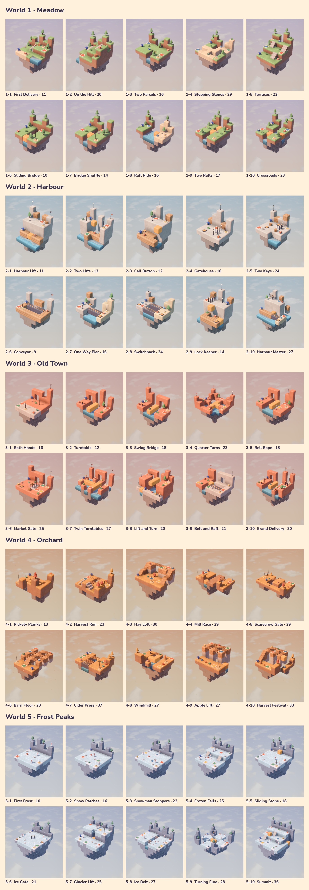

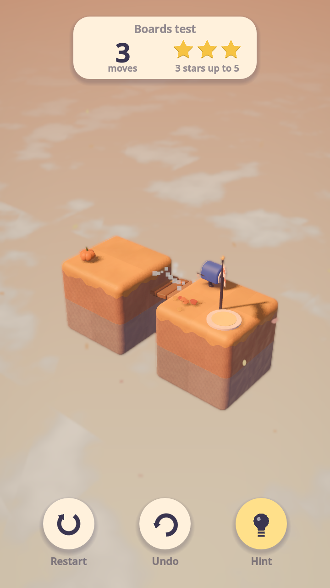 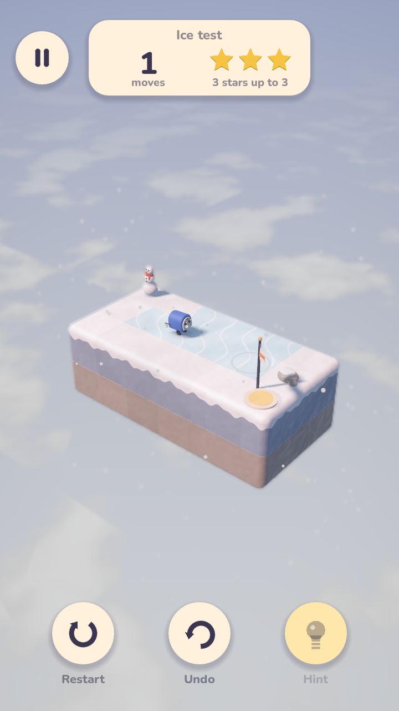

`tools/check_levels.gd` checks levels without a window. It loads every
level in catalogue order (or the paths given), solves each with the hint
solver, and fails if a level is broken, cannot be finished, or has a
three-star limit other than its fewest moves. It warns when a world folder
does not match the level's `world`, and when a hint from the start looks at
more than 5,000 states, the budget for answering quickly on a phone (the
largest level, 4-7 Cider Press, looks at about 3,800). `--plan` prints each
level's shortest solution and `--fix-stars` rewrites each level's `stars`
from it: the best, then best + max(2, 25%), then best + max(4, 60%).

```bash
godot --headless --path . -s res://tools/check_levels.gd
godot --headless --path . -s res://tools/check_levels.gd -- --plan res://levels/world_2/level_3.json
godot --headless --path . -s res://tools/check_levels.gd -- --fix-stars
```

## Mechanisms

Mechanisms are the orange moving parts of a level, listed under
`mechanisms`. Each is an object with a unique `id` and a `type`. One of
each, taken from the test levels in `dev/mechanisms/` (they would not all
fit in one level):

```json
"mechanisms": [
	{ "id": "s1", "type": "slider", "cells": [[2, 0, 0], [3, 0, 0]], "axis": "z", "min": 0, "max": 2 },
	{ "id": "e1", "type": "elevator", "cells": [[2, 0, 1]], "travel": 2, "start": "top" },
	{ "id": "r1", "type": "rotator", "cells": [[3, 0, 0], [3, 0, 1], [3, 0, 2]], "pivot": [3, 0, 1], "handle": [1, 1, 0] },
	{ "id": "c1", "type": "conveyor", "cells": [[2, 0, 0], [3, 0, 0], [4, 0, 0]], "dir": "+x" },
	{ "id": "b1", "type": "button", "pos": [5, 1, 2], "targets": ["e1"] },
	{ "id": "g1", "type": "gate", "cells": [[4, 1, 0], [4, 1, 1]], "buttons": ["b1", "b2"] }
]
```

| Type | Keys | What it does |
| --- | --- | --- |
| `slider` | `cells`, `axis` (`x`, `y` or `z`), `min`, `max`, `start` (default 0) | Blocks the player drags along `axis`, from offset `min` to `max` cells. One move per drag, however far. |
| `elevator` | `cells`, `travel`, `start` (`"bottom"`, the default, or `"top"`) | A platform with two stops `travel` cells apart. Stepping onto it sends it to the other stop, carrying the courier. |
| `rotator` | `cells`, `pivot`, `handle`, `start` (quarter turns, 0–3) | Blocks that turn a quarter about `pivot` (counter-clockwise seen from above) each time the crank standing in the `handle` cell is tapped. One move per turn. |
| `conveyor` | `cells`, `dir` (`+x`, `-x`, `+z`, `-z`), `running` (default `true`) | A straight, unbroken belt. The courier can step on from any side but is carried off along `dir`, and ridden cells are not moves. Parcels on it are pushed to the far end. |
| `button` | `pos`, `targets`, `on` (default `false`) | A plate the courier switches on or off each time it steps on it. Each switch also works every target: an elevator goes to its other stop, a rotator turns a quarter, a slider runs to its far end (or as far as it can), and a conveyor starts or stops. |
| `gate` | `cells`, `buttons` | Bars that sink when all of its `buttons` are on and rise again when any is off, unless the courier or a parcel is standing in them. |

Coordinates follow the rest of the level: a slider's, elevator's, rotator's
or conveyor's `cells` (and the `pivot`) are *block* cells, given in state 0
(offset 0, the bottom stop, no turn), and `start` moves them from there. A
button's `pos`, a gate's `cells` and a rotator's `handle` are *standing*
cells. A part that moves stops short of anything in its way (blocks, other
mechanisms, solid props, closed gates, pads, the exit, buttons, and the
courier or parcels not riding it); whatever stands on it rides along.
Pads, the exit and buttons may not stand on a moving part. The loader also
reports unknown types, repeated ids, overlapping blocks, buttons aimed at a
missing mechanism (or at one a button cannot switch), gates without buttons,
and bent or broken belts.

`core/Mechanism.gd` holds a mechanism's geometry in each state and
`core/LevelState.gd` applies the rules; `entities/Mechanism*.gd` animate
them with an eased overshoot and a puff of dust (`render/Effects.gd`). When
a part moves under a walking courier, the courier stops so the player can
re-plan. `dev/mechanisms/` has one small test level per type.

 

## Undo, hints, stars and saving

**Undo** takes back the last action, moves and all: a whole walk (even one
still going), a slider drag, a crank turn or a restart. Up to 300 are kept.
`game/Level.gd` records a `LevelState` snapshot before each action and, on
undo, rebuilds everything shown from the restored state at once. Undo waits
while a mechanism is moving and is off once the level is finished.

**Restart** goes back to the start; undo brings the game back, unless it
was finished.

**Hints** come from `core/Solver.gd`, a breadth-first search over
`LevelState` in which walked steps, ice slides, slider drags and crank
turns cost a move and belt rides cost nothing (0-1 BFS), so it finds the fewest moves to
finish from wherever the player is. A hint shows the first step of that
plan: a glowing arrow over where one tap should walk (as far as the plan goes
before something happens, with a trail of dots), or over the slider or crank
to work along with a see-through ghost of where the part should end up. A
toast says what to do ("Drag the orange block to the outline."). Hints are
free in world 1; from world 2 on, the first Hint in a level offers a short
video that turns them on for the rest of it (see [Ads](#ads)). The plan is
reused while the player follows it, and the search gives
up past 150,000 states so a hint never hangs. Following the hints alone
always earns three stars.

**Stars**: each level's three-star limit is the solver's best and the
other two are set from it (`tools/check_levels.gd --fix-stars`);
`tools/check_levels.gd` and `tools/test_levels.gd` check that every level
still agrees.

**Saving**: `core/Progress.gd` keeps the best stars and moves per level and
the game in progress (state and undo history) in `user://progress.json`. It
writes a temporary file and then moves it into place, so a crash mid-write
never loses the save, and an unreadable save is kept as `.bad` while play
starts afresh. The game in progress is saved when the app is paused, loses
focus or closes, and when the level is left; it is picked up again only if
the level file has not changed since (an MD5 fingerprint) and the saved state
still fits the level.

 

## Menus

`ui/Menu.tscn` is the front end (`ui/Menu.gd`), drawn in the 720 x 1280
base viewport and kept inside the screen's safe area (notches and rounded
corners) by `Ui.fit_to_safe_area`:

- **Splash**: the title on cream, once per launch, fading into
- **Main menu**: the title over a live diorama of the next level to play,
  slowly turning and building itself up, with the stars earned so far,
  **Play** (the next level, named underneath), **Levels** and **Settings**;
- **World select**: a card per world with its own small turning diorama, its
  stars and how many of its levels are delivered; a world opens with its
  first level;
- **Level grid**: the world's levels with the stars earned on each;
  the next one is outlined, and a level opens once the one before it is
  finished.

`ui/Game.gd` swaps between the menu and the levels under a soft cream veil,
and remembers which screen and world the menu goes back to. The level's HUD
(`ui/Hud.gd`) adds a pause card (Resume, Restart, Settings, Levels, Home)
and the finish card's Levels button. Text is set in Nunito
(`fonts/Nunito.ttf`); the buttons, icons and cards are drawn in code
(`ui/Ui.gd`, `ui/TouchButton.gd`).

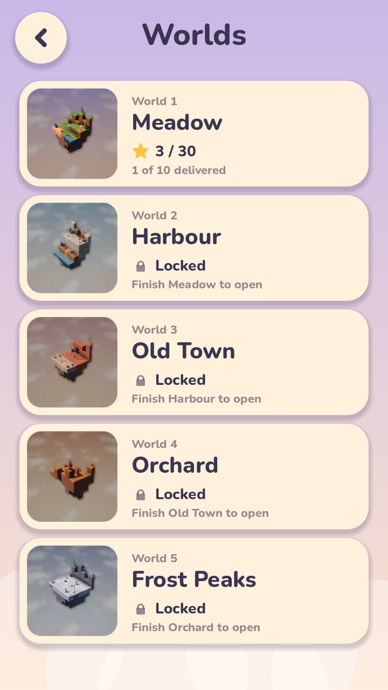 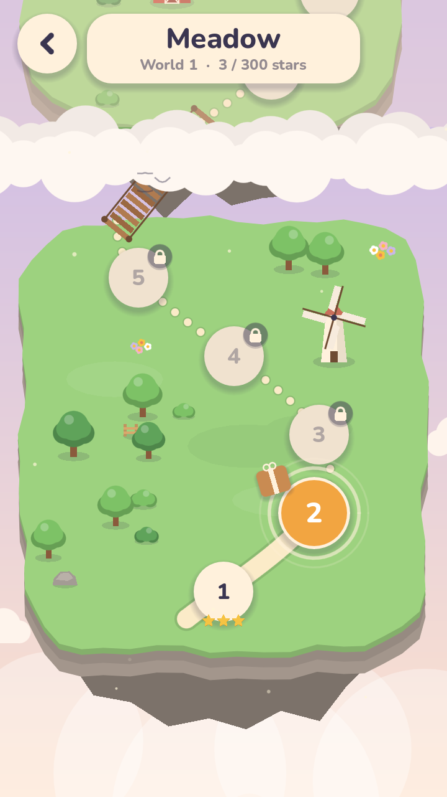 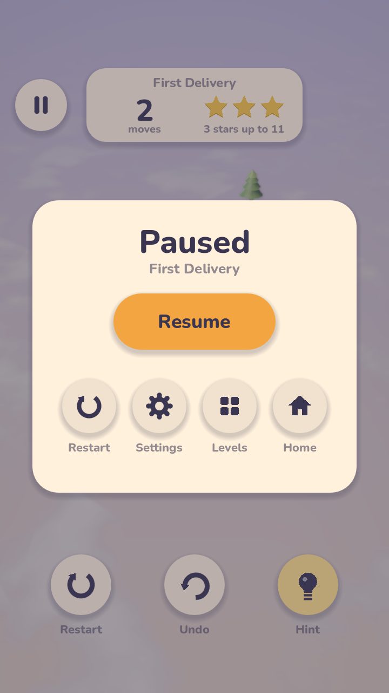

## Settings

`ui/SettingsCard.gd` opens from the main menu and the pause card: music and
sound volumes, haptics, tilt-shift (the camera's soft focus) and the
graphics quality (Low, Medium, High). `core/Settings.gd` keeps them in
`user://settings.json`, written to a temporary file and then moved into
place, and every change takes effect at once. Where the law gives the
player a say over ads (the EEA, the UK and Switzerland, for instance), an
**Ad privacy** row opens Google's privacy options; elsewhere it isn't there.

The foot of the card has the version number and a link to the
[privacy policy](PRIVACY.md). The version number has a hidden use: tap it
five times quickly to bring up the performance readout (see below), and
five more to put it away.

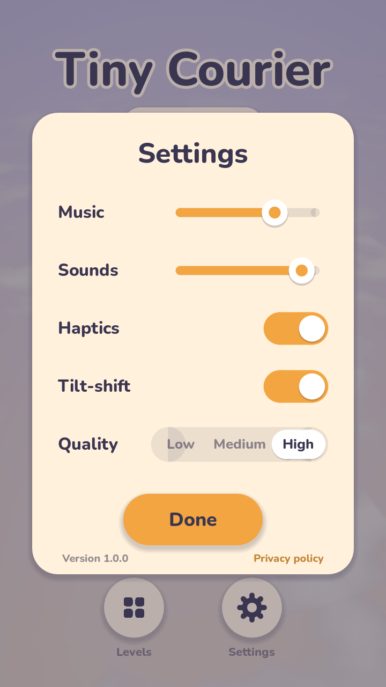

## Ads

The game shows Google AdMob ads, kept calm and rare:

- **World 1 has none.** The ads don't even start there: no consent form,
  no ads SDK, nothing loaded.
- **Hint video** (rewarded), only when the player asks: from world 2 on,
  the first Hint in a level opens a card, "Need a hint?", offering a short
  video that turns hints on for the rest of that level (a small play mark
  on Hint shows a video is needed). **Not now** or back closes it with no
  video and no hint. A video closed early gives no hint; if none can play
  (offline, nothing to show, no consent), the hint is simply free.
- **Level break** (interstitial), from world 2 on, at most once every 3 or
  4 levels finished (picked afresh each time), and only on the
  level-complete card, as the player moves on from it with Next, Levels or
  back. Never on Replay, never after a level that was restarted along the
  way or finished without a star, never within 4 minutes of another ad, and
  never mid-puzzle.
- **No banners**, and ad content is limited to PG.

`core/Ads.gd` holds these rules and **the one switch**, `Ads.enabled`: off,
Google's consent form never shows, the ads SDK never starts, hints are free
and no break plays. The tests turn it off, as does `--no-ads` on the
command line; a "remove ads" purchase would turn it off too. The count
towards the next break is kept in `user://ads.json`.

On first reaching world 2 (after the splash, or on opening a world-2
level), the game asks for consent with Google's User Messaging Platform
form where the law requires it, then starts the Mobile Ads SDK, which loads
one ad of each kind ahead of time. Settings then offers the privacy options
where required (see [Settings](#settings)).

**On Android** the ads come from a small Godot plugin, the `TinyCourierAds`
singleton (`android-plugin/`, Kotlin, after the one in the developer's
other game), which `addons/tiny_courier_ads/` adds to Android exports along
with the Google Mobile Ads SDK 25.5.0, the UMP SDK 4.0.0 and the ad ids.
Its built `.aar` is checked in; after changing the plugin, rebuild it with a
JDK 17 to 23:

```bash
cd android-plugin && ./gradlew copyToAddon
```

**Ad ids.** Debug exports always use Google's test ids, and so do release
exports until the game is live on Google Play. Then export with
`TINY_COURIER_LIVE_ADS=1` for the game's own: the AdMob app
`ca-app-pub-6111568882988372~2256360108` with its units "Hint video"
(rewarded) and "Level break" (interstitial). Your own phones must still get
test ads (tapping your own ads breaks AdMob's rules): put their hashed
device ids, which the SDK prints to logcat, in `ADMOB_TEST_DEVICE_IDS`,
comma-separated.

```bash
TINY_COURIER_LIVE_ADS=1 godot --headless --path . --export-release "Android" export/TinyCourier.aab
```

**Away from phones** there are no ads; `--ads-preview` puts a stand-in in
their place (`Ads.Preview`), a plain "Test ad" card for each, so the
placements can be tried on the desktop:

```bash
godot --path . -- --ads-preview
```

**Before publishing:**

- The [privacy policy](PRIVACY.md) is linked from Settings at
  `https://github.com/manpreetgugga/toolcourier/blob/main/PRIVACY.md`, so
  it must be on `main`; give the same address in Play Console. Fill in
  Play's Data safety form to match it (advertising ID, IP address and app
  interactions, collected by the AdMob SDK for advertising, fraud
  prevention and analytics; nothing shared by the developer). The game's
  target audience in Play Console must be 13 and over to match it; a
  younger audience needs AdMob's child-directed settings instead.
- [`app-ads.txt`](app-ads.txt) must be served at the root of the developer
  website listed in Play Console (for example
  `https://<your-site>/app-ads.txt`); AdMob checks it there, not in the
  app. It covers every app of the AdMob account, so one file is enough.
- In AdMob, link the app to its Play listing once it is live; until then
  AdMob limits serving for it.

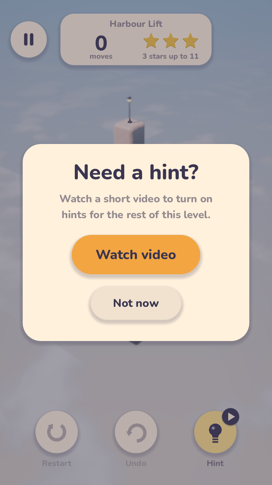 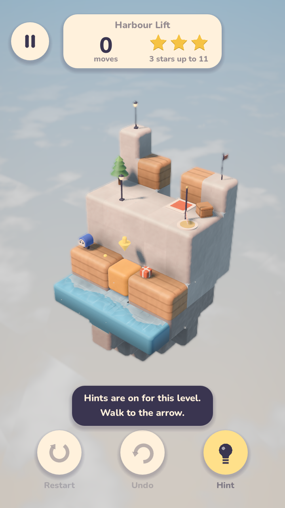 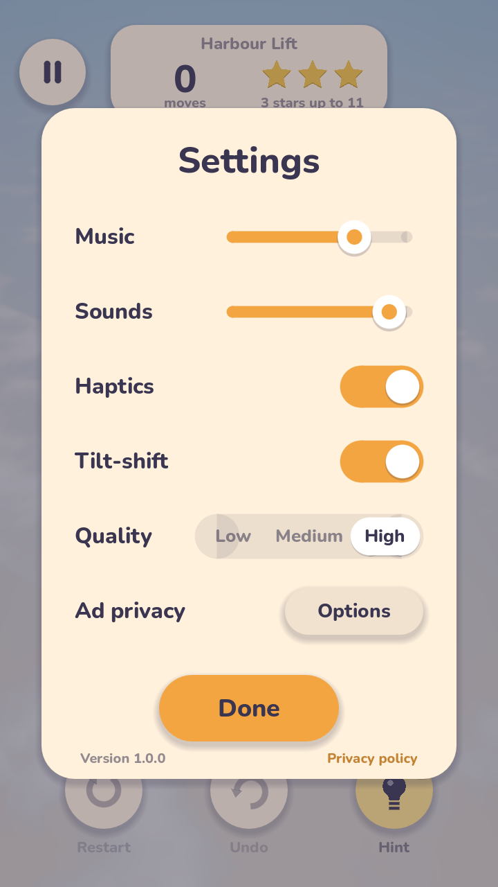

## Performance and quality

The game is drawn with Godot's Mobile renderer and costs little to draw: a
level is 27–46 draw calls and 20–44 thousand triangles (the world select,
with five small dioramas turning, is the busiest screen at 142 draw calls).
Nearly all of a frame's cost is per pixel instead: the tilt-shift blur,
multisampling, shadows and the cloud sea. So the quality presets mostly
decide how many pixels the 3D view is drawn with (`Settings.apply_quality`
and `StageLighting`):

| | Low | Medium | High |
| --- | --- | --- | --- |
| Most pixels in the 3D view | 0.8 million | 1.3 million | 2.6 million |
| 3D view on a 1080 × 2400 phone | 600 × 1333 | 764 × 1699 | 1080 × 2400 |
| Multisampling | off | 2× | 4× |
| Sun shadows | 1024 px map, one split, hard | 2048 px, two splits, soft | 4096 px, two splits, softer |
| Tilt-shift blur | box, few samples | box, few samples | hexagon, more samples |
| Glow | off | on | on |
| GPU time, level 1-1 | 0.8 ms | 1.9 ms | 4.3 ms |
| Video memory, level 1-1 | 93 MB | 134 MB | 247 MB |

The 3D view is scaled up to the screen; the interface is always drawn at
the screen's own resolution, so text stays sharp, and a screen smaller than
the budget (or a desktop window) is drawn in full. Phones start on Medium
and are held at 60 frames per second, which saves battery on 90 and 120 Hz
screens; desktops start on High. Before this, every quality drew the 3D at
full size, and Medium took 3.5 ms and 183 MB.

The times above are from a desktop GTX 1650 rendering offscreen at
1080 × 2400, so they are far below a phone's; compare them with each other.
Draw calls, render sizes and video memory carry over to phones as they are.
To measure, run (it needs a renderer; `--size` defaults to 1080x2400):

```bash
godot --path . -s res://tools/benchmark.gd -- --size=1080x2400 --out=docs/screenshots
```

It prints GPU and frame time, draw calls and triangles (all, and for the
shadow maps), the 3D size and memory for the main menu, the world select
and three levels at each quality, and saves `step10_quality.png`, level 1-1
at Low, Medium and High side by side:

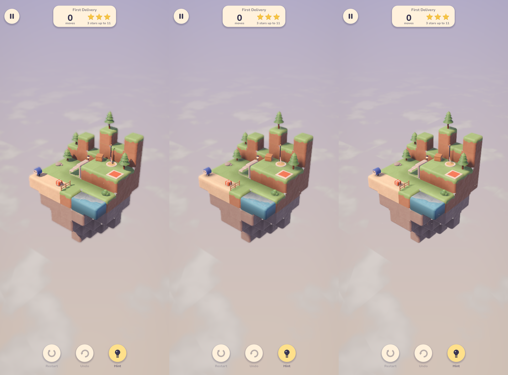

**On a phone**, five taps on the version number in Settings bring up a
readout under the pause button: frames per second, the CPU and GPU time of
a frame, draw calls, the 3D size and quality, and memory (what the engine
has allocated, plus video memory). It stays up across screens until put
away. A phone's own count of the game's memory, which also takes in the
engine's code and the graphics driver, comes from adb (look at **TOTAL
PSS**):

```bash
adb shell dumpsys meminfo com.manpreetgugga.tinycourier
```

On the Android emulator, which translates ARM code and emulates the GPU,
that count is several times too high, and the frame rate means little, so
only a real phone gives the true figures. The engine itself holds 70–100
MB; most of the rest is video memory, which Low cuts the most if a phone
runs short.

## Sound and haptics

`audio/AudioManager.gd` (the autoload `Audio`) plays named cues on the
**SFX** bus and a calm ambient loop per world on the **Music** bus (both
send to **Master**; see `default_bus_layout.tres`), crossfading when the
world changes and ducking the music under the finish jingle. Anything calls
`AudioManager.play(&"step")` or `AudioManager.play_music(world)`.

| Cue | Plays when |
| --- | --- |
| `step`, `glide`, `creak` | the courier steps on ground, slides on ice, crosses dry boards |
| `tap`, `error` | a tap walks somewhere, or there is no way there |
| `pickup`, `drop`, `pad_complete` | a parcel is taken, set down, its pad lights |
| `slide`, `rotate`, `snap` | a slider or elevator moves, a rotator turns, a part locks in place |
| `fall` | dry boards drop away |
| `level_complete` | the level is finished |
| `ui_click` | a button is pressed |
| `whoosh` | the diorama builds up or comes apart |

Every sound and loop is generated by `tools/make_audio.gd` (see
[Building](#building) and [CREDITS.md](CREDITS.md)).

`core/Haptics.gd` gives a light tick for a tap on a button or the diorama
and a firmer one when a mechanism snaps into place, on phones only, unless
haptics are off.

## Build-up and particles

`render/Assembly.gd` builds each level up as it opens: blocks, stairs and
props pop up from below one after another, lowest layer first and each layer
from the middle outwards, then the courier, parcels, pads and the exit pop
in. Leaving a level plays it backwards, a little faster. The block and prop
meshes carry their anchors in a vertex channel, so the whole diorama is
driven from one shader uniform (`shaders/build_up.gdshaderinc`) with no
extra nodes.

`render/Effects.gd` adds a soft dust puff where a mechanism stops, sparkles
when a pad lights and confetti at the finish; summer levels have a few slow
dust motes drifting in the light (`render/Weather.gd`).

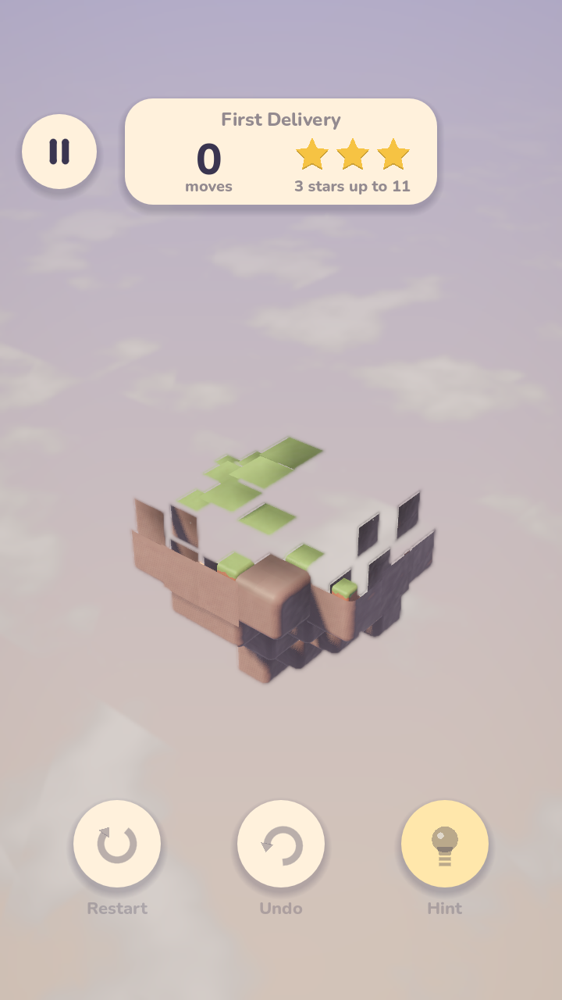 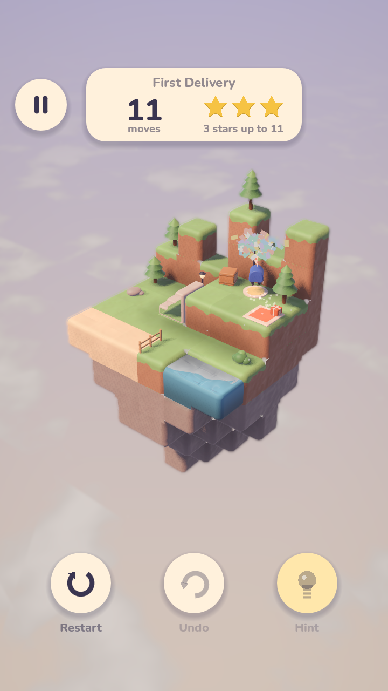

## Project layout

```
core/       grid, pathfinding, level loading and rules, solver, saved progress,
            the level catalogue, settings, haptics and the ads' rules
game/       the level scene that plays a level
render/     palette, stage lighting, weather, effects, the build-up,
            procedural meshes and props
shaders/    block, clay, water, cloth, sky and effect shaders
entities/   courier, parcels, pads, exit, mechanisms, dry boards
camera/     orbit camera
ui/         menus, scene changes, HUD, pause, settings and finish cards, buttons
audio/      the sound player, generated sound effects and world loops
fonts/      Nunito and its licence
levels/     the 50 levels, levels/world_<n>/level_<n>.json
icons/      the app icon and its adaptive layers, rendered by tools/make_icon.gd
tools/      capture, benchmark, icon and sound generation, tests and
            validation scripts
dev/        sandbox level, one test level per mechanism, ice and boards,
            the icon's island
addons/     tiny_courier_ads: adds the ads plugin, its libraries and the ad
            ids to Android exports
android-plugin/
            the ads plugin's Android source (Kotlin, built with Gradle)
```

All art is generated procedurally in code (the app icon is rendered from
the game), and all sound by `tools/make_audio.gd`; there are no external
model, texture or audio files.
The one outside asset is the Nunito font, and the Android build adds
Google's ads libraries; see [CREDITS.md](CREDITS.md).
