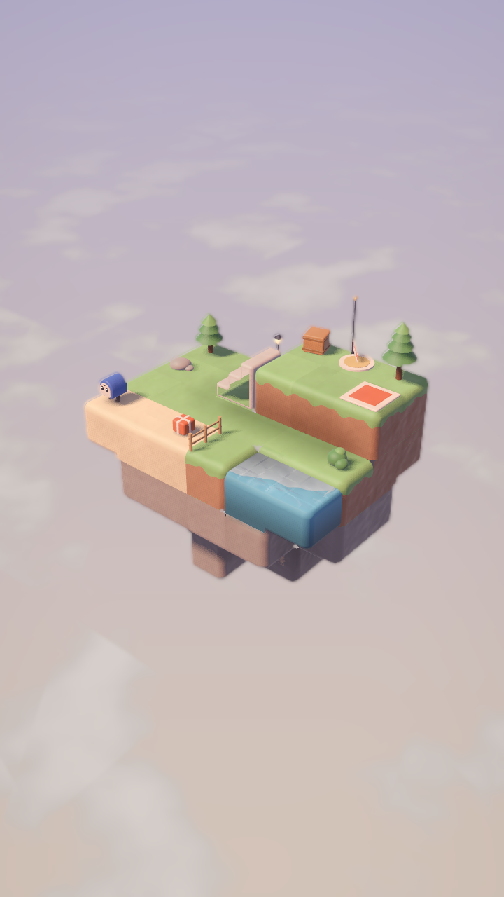
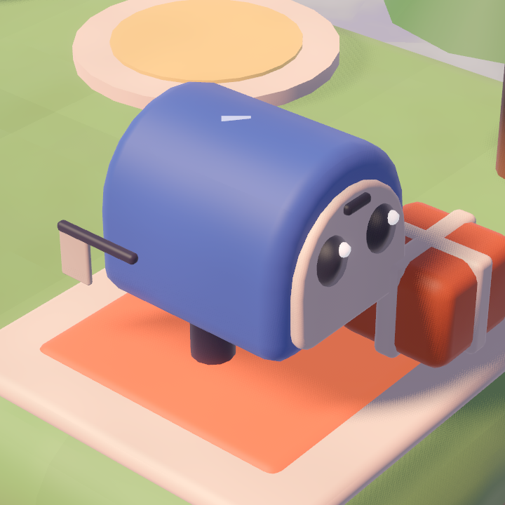

# Tiny Courier

A calm 3D diorama puzzle game for Android, built with Godot 4 (GDScript).
A little walking mailbox delivers parcels across small floating clay
dioramas: drag to rotate the diorama, tap a spot to walk there, and operate
the orange mechanisms to open a path.

> **Status:** early development (build steps 1–5 of 10 done: lighting and sky,
> clay block meshing, orbit camera with tap picking, the courier with
> pathfinding, and playable levels from JSON with parcels, pads and an exit).

 

## How a level plays

Each level is a floating clay diorama. The courier walks to wherever you
tap, picks up a parcel by walking onto it (one at a time in worlds 1–2, two
in world 3), and drops it automatically on the pad of the same colour. Once
every pad is filled the exit's pennant runs up its post; walking onto the
exit finishes the level. Every cell walked is a move, and each level sets
three move limits for three, two and one star.

The rules live in `core/LevelState.gd`, with no visuals, so the solver and
undo can reuse them; `game/Level.gd` builds the scene and animates them:
the mailbox flaps its door to swallow a parcel and raises its flag in the
parcel's colour, flaps it again to pop the parcel out onto the pad, and the
pad lights up with a burst of sparkles.

## Art direction

The game should never be mistaken for an existing block-puzzle game, so it
deliberately avoids the crisp bevelled-cube grid and a one-eyed robot hero:

- **Soft clay diorama.** Neighbouring blocks merge into one sculpted lump with
  big rounded outside edges, wrap lighting with a warm glow at the shadow
  line, a soft sheen, hand-pressed colour mottling and shallow thumb dents.
- **Dusk sky with a sea of clouds** below the diorama, turning with the camera.
- **The courier is a walking mailbox**: its flag pops up when it carries a
  parcel, and its door flap opens to drop it on the pad.

Clay was picked over a storybook-ink look and a natural-rock look; see
`docs/screenshots/look_comparison.png` (clay, storybook, isles).

 

## The courier

`entities/Courier.gd` walks cell to cell (0.28 s per cell) and animates
procedurally: breathing while idle, a waddle with swinging legs and a forward
lean, a squash when it lands, a puzzled head tilt, a happy hop-and-spin with
"^ ^" eyes, and the odd blink. `render/CourierBuilder.gd` builds it from clay
parts made by `render/ClayShapes.gd` (rounded extrusions), with a soft blob
shadow under its feet.

Movement rules (`core/Pathfinder.gd`, an AStar3D graph over the grid):

- the courier stands in an empty cell on top of a block with a walkable top
  (anything but water and stairs);
- it steps one cell at a time to a horizontal neighbour at the same height,
  never jumping gaps or dropping down;
- the only way up or down is stairs: a stairs block links the cell at its
  foot with the cell past its top, one level higher.

Tapping a block walks to the cell on top of it (or onto stairs). A white
ripple marks the destination; a red ripple and a puzzled tilt mean there is
no way there. A new tap mid-walk re-routes after the current step.

## Requirements

- Godot **4.7** or newer (standard build, no .NET needed).
- Renderer: Mobile (Vulkan), with automatic fallback to Compatibility.

## Running

Open the folder in Godot and press **Play**, or from a terminal:

```bash
godot --path .
```

The main scene, `game/Level.tscn`, plays world 1 level 1 until the menus
exist; set its `level_path` to play another level.

## Controls

| Gesture | Action |
| --- | --- |
| One-finger drag | Orbit the diorama (pitch 15°–70°), with inertia when flicked |
| Pinch (mouse wheel on desktop) | Zoom, 0.7×–1.4× |
| Tap | Walk to the spot under the finger (moves of under 12 px still count as taps) |
| Double-tap empty space | Ease back to the default view |

The camera (`camera/OrbitCamera.gd`) fits its distance so the diorama fills
75% of the shorter screen axis from every yaw. Taps are resolved with a voxel
raycast against the grid (`core/Grid.gd`), so no physics bodies are needed.

## Tests

The test scripts need a renderer (not `--headless`), print PASS/FAIL per
check and exit non-zero on any failure. The camera and courier tests play
`dev/sandbox_level.json`.

`tools/test_orbit_camera.gd` drives the sandbox with synthetic touch events
and checks tap vs drag, inertia, pitch limits, pinch zoom, double-tap reset,
picking and the fit:

```bash
godot --path . --resolution 405x720 -s res://tools/test_orbit_camera.gd -- --out=docs/screenshots
```

`tools/test_courier.gd` checks walkability and stairs in the pathfinder, then
taps through the real input path: climbing to the walkway, an unreachable
tap, re-routing mid-walk and walking back down. It also saves close-up
portraits of the courier:

```bash
godot --path . --resolution 405x720 -s res://tools/test_courier.gd -- --out=docs/screenshots
```

`tools/test_level.gd` checks the loader's error reports and the delivery
rules (including undo snapshots), then plays world 1 level 1 by tapping and
expects the minimum of 11 moves for three stars:

```bash
godot --path . --resolution 405x720 -s res://tools/test_level.gd -- --out=docs/screenshots
```

## Screenshots from the command line

`tools/capture.gd` renders a scene for a number of frames and saves a PNG:

```bash
godot --path . --resolution 720x1280 -s res://tools/capture.gd -- --scene=res://game/Level.tscn --out=docs/screenshots/level.png --frames=90
```

Add `--size=720x1280` to render offscreen at an exact size (useful when the
desktop is smaller than the capture), and `--crop=X,Y,W,H` to save only a
region for close-ups. The tool also prints draw calls and triangle counts.

## Blocks

`render/BlockMesher.gd` turns a level's cells (`Vector3i -> block type`) into
one mesh with a surface per material:

- faces touching another solid block are culled and neighbours merge into
  one smooth surface;
- only the outside edges of the combined shape are rounded (0.17 m radius,
  four segments per edge);
- voxel ambient occlusion, a lighter top / darker bottom tint and a small
  per-block colour jitter (which keeps cells faintly readable) are baked into
  vertex colours;
- water is lowered slightly, merges with neighbouring water and gets its own
  animated shader.

Block types: `stone`, `dark_stone`, `sand`, `grass` (dirt sides with a grass
lip), `wood` (plank lines), `brick`, `water`, `accent` for interactive parts
(pulsing orange), and `stairs`, which has its own clay mesh and a facing (the
direction it climbs). Colours live in `render/Palette.gd`, materials in
`render/BlockMaterials.gd`, the clay surface in `shaders/block.gdshader` with
the shared clay lighting in `shaders/clay_common.gdshaderinc`.

## Levels

Levels are JSON files in `levels/world_<n>/level_<n>.json`. Coordinates are
whole cells; `y` is up. `start`, `exit` and the positions of parcels and pads
are *standing* cells: the empty cell the courier occupies, directly above the
block it stands on.

```json
{
	"name": "First Delivery",
	"world": 1,
	"palette": "meadow",
	"blocks": [[0, 0, 0, "grass"], [1, 0, 0, "sand"], [2, 1, 1, "stairs", "+x"]],
	"props": [[0, 1, 0, "tree_small", 0, true], [3, 1, 3, "fence", 90]],
	"mechanisms": [],
	"packages": [{ "pos": [2, 1, 3], "color": "red" }],
	"pads": [{ "pos": [5, 2, 1], "color": "red" }],
	"start": [0, 1, 3],
	"exit": [4, 2, 0],
	"stars": [11, 14, 18]
}
```

| Key | Meaning |
| --- | --- |
| `name`, `world` | Title, and the world (1–3) it belongs to. |
| `palette` | Sky and light theme: `meadow`, `harbor` or `old_town`. |
| `blocks` | `[x, y, z, type]`. Types: `stone`, `dark_stone`, `sand`, `grass`, `wood`, `brick`, `water`, `accent`. Stairs are `[x, y, z, "stairs", facing]`, climbing towards `facing` (`+x`, `-x`, `+z`, `-z`); `stairs_wood` and `stairs_brick` change the material. |
| `props` | Decor, `[x, y, z, type, rotation?, solid?]`: `tree_small`, `tree_tall`, `bush`, `lamp_post`, `flag`, `crate`, `fence`, `rock`. Rotation is in degrees about up; fences run along the cell's −z edge before rotation. Props are walk-through unless `solid` is `true`. |
| `mechanisms` | Moving parts (build step 6). |
| `packages`, `pads` | `{ "pos": [x, y, z], "color": ... }` with colours `red`, `green`, `blue`, `yellow`. Each parcel needs exactly one pad of its colour. |
| `start`, `exit` | Where the courier begins and where it finishes. |
| `stars` | Move limits for three, two and one star, not decreasing. |
| `carry` | Optional: parcels carried at once (default 1, or 2 from world 3). |

To add a level, write the file, set `game/Level.tscn`'s `level_path` to it
and press F6. `core/LevelLoader.gd` checks the level as it loads and prints
every problem with where it is (for example `packages[0]: (2, 0, 3) is not
a cell the courier can stand in`), and the level will not start until they
are fixed. `dev/sandbox_level.json` is a small test level used by the tests.

## Project layout

```
autoload/   global singletons (game state, audio, saving)
core/       grid, pathfinding, level loading and rules, undo
game/       the level scene that plays a level
render/     palette, stage lighting, procedural meshes and props
shaders/    block, clay, water, cloth, sky and effect shaders
entities/   courier, parcels, pads, exit, mechanisms
camera/     orbit camera
ui/         menus and HUD
levels/     level JSON, one folder per world
tools/      capture, tests and validation scripts
dev/        sandbox level used during development
```

All art is generated procedurally in code; there are no external model or
texture files.
