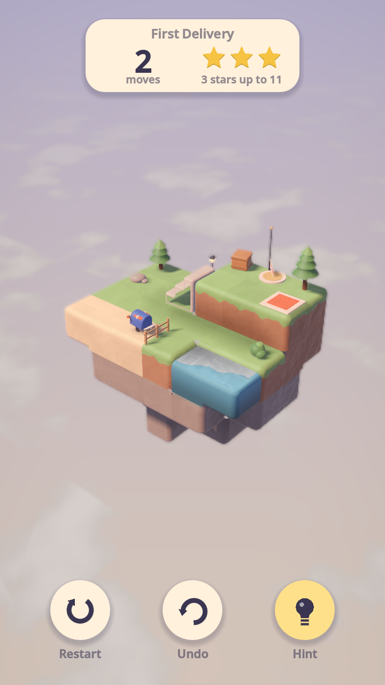
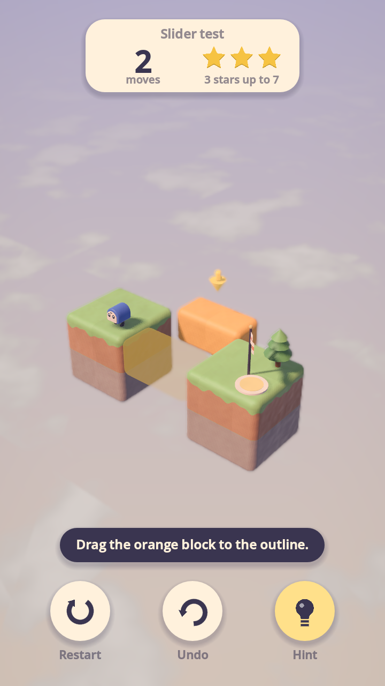
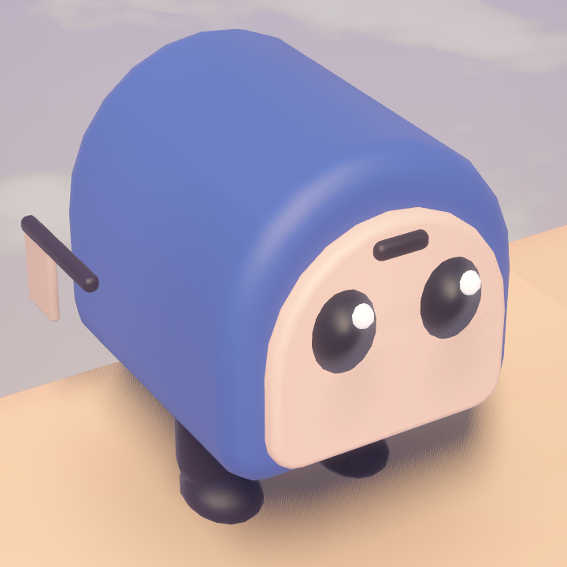
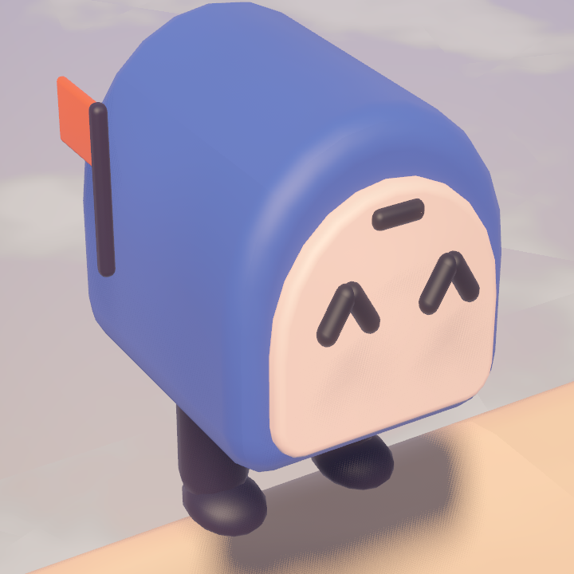
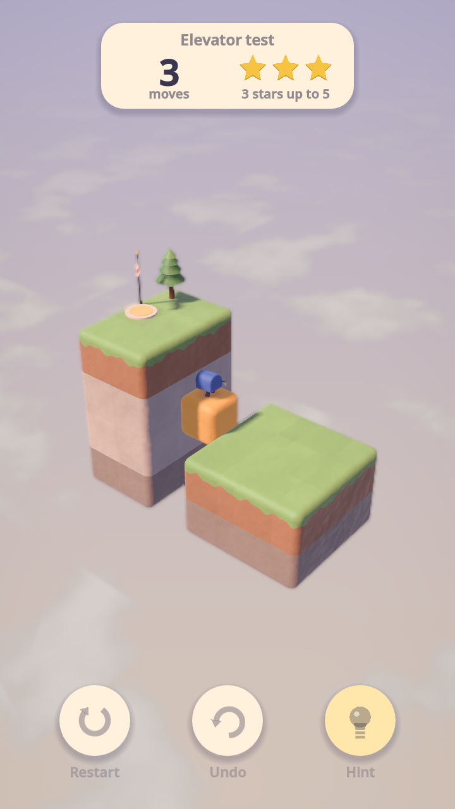
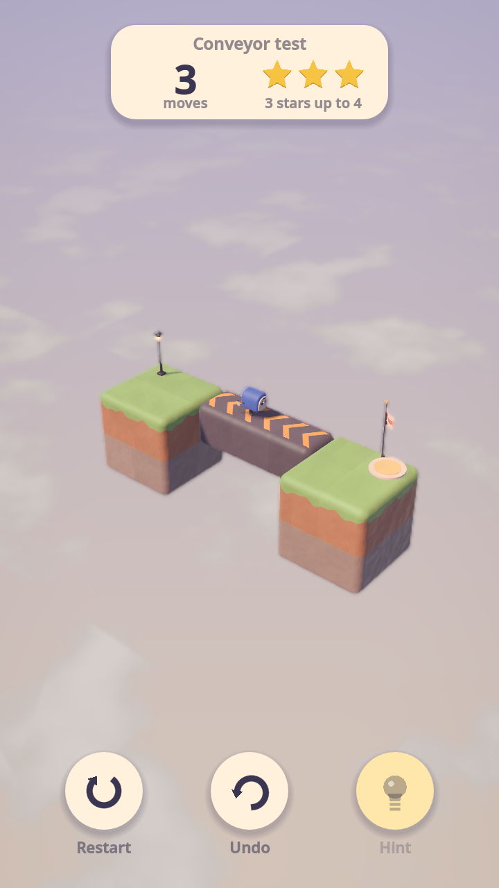
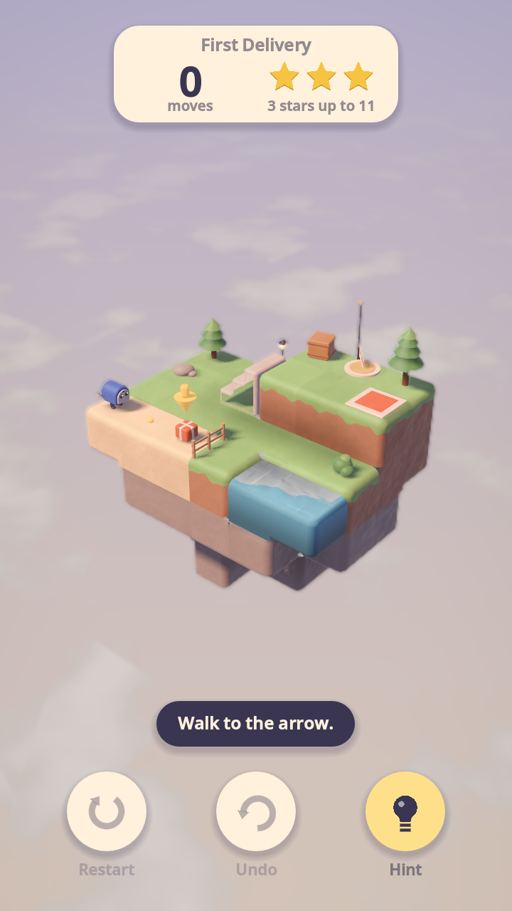
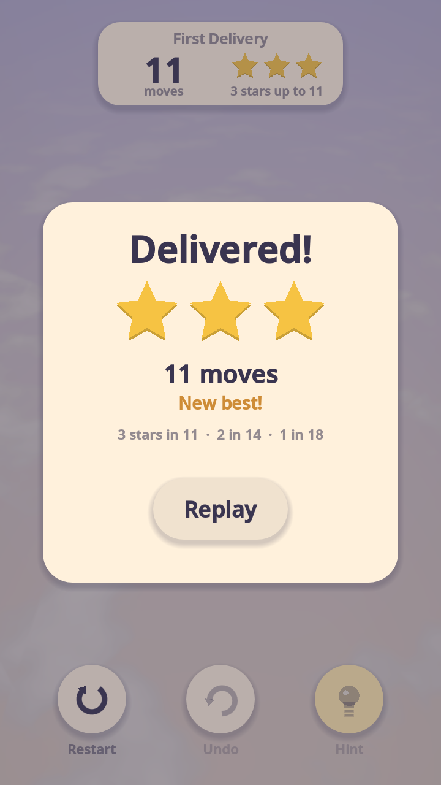

# Tiny Courier

A calm 3D diorama puzzle game for Android, built with Godot 4 (GDScript).
A little walking mailbox delivers parcels across small floating clay
dioramas: drag to rotate the diorama, tap a spot to walk there, and operate
the orange mechanisms to open a path.

> **Status:** early development (build steps 1–7 of 10 done: lighting and sky,
> clay block meshing, orbit camera with tap picking, the courier with
> pathfinding, playable levels from JSON with parcels, pads and an exit,
> mechanisms (sliders, elevators, buttons, conveyors, rotators and gates),
> and undo, restart, hints, stars and saved progress).

 

## How a level plays

Each level is a floating clay diorama. The courier walks to wherever you
tap, picks up a parcel by walking onto it (one at a time in worlds 1–2, two
in world 3), and drops it automatically on the pad of the same colour. Once
every pad is filled the exit's pennant runs up its post; walking onto the
exit finishes the level. Every cell walked is a move, and each level sets
three move limits for three, two and one star.

The orange parts move (see [Mechanisms](#mechanisms)): drag a slider, tap a
crank to turn a bridge, step on an elevator to ride it or on a button to
switch something. Dragging a slider or turning a crank costs one move;
riding a belt or an elevator costs nothing.

The rules live in `core/LevelState.gd`, with no visuals, so the solver and
undo can reuse them; `game/Level.gd` builds the scene and animates them:
the mailbox flaps its door to swallow a parcel and raises its flag in the
parcel's colour, flaps it again to pop the parcel out onto the pad, and the
pad lights up with a burst of sparkles.

The HUD shows the level's name, the moves so far and a star meter (the stars
you would earn by finishing now, and the move count that keeps them), with
Restart, Undo and Hint buttons at the bottom. Finishing brings up a card with
the stars earned, the best so far, the limits, and Replay / Next. See
[Undo, hints, stars and saving](#undo-hints-stars-and-saving).

## Art direction

The game should never be mistaken for an existing block-puzzle game, so it
deliberately avoids the crisp bevelled-cube grid and a one-eyed robot hero:

- **Soft clay diorama.** Neighbouring blocks merge into one sculpted lump with
  big rounded outside edges, wrap lighting with a warm glow at the shadow
  line, a soft sheen, hand-pressed colour mottling and shallow thumb dents.
- **Dusk sky with a sea of clouds** below the diorama, turning with the camera.
- **The courier is a walking mailbox**: its flag pops up when it carries a
  parcel, and its door flap opens to drop it on the pad.

Clay was picked over a storybook-ink look and a natural-rock look; see
`docs/screenshots/look_comparison.png` (clay, storybook, isles).

 

## The courier

`entities/Courier.gd` walks cell to cell (0.28 s per cell) and animates
procedurally: breathing while idle, a waddle with swinging legs and a forward
lean, a squash when it lands, a puzzled head tilt, a happy hop-and-spin with
"^ ^" eyes, and the odd blink. `render/CourierBuilder.gd` builds it from clay
parts made by `render/ClayShapes.gd` (rounded extrusions), with a soft blob
shadow under its feet.

Movement rules (`core/Pathfinder.gd`, an AStar3D graph over the grid):

- the courier stands in an empty cell on top of a block with a walkable top
  (anything but water and stairs);
- it steps one cell at a time to a horizontal neighbour at the same height,
  never jumping gaps or dropping down;
- the only way up or down is stairs: a stairs block links the cell at its
  foot with the cell past its top, one level higher.

Tapping a block walks to the cell on top of it (or onto stairs). A white
ripple marks the destination; a red ripple and a puzzled tilt mean there is
no way there. A new tap mid-walk re-routes after the current step.

## Requirements

- Godot **4.7** or newer (standard build, no .NET needed).
- Renderer: Mobile (Vulkan), with automatic fallback to Compatibility.

## Running

Open the folder in Godot and press **Play**, or from a terminal:

```bash
godot --path .
```

The main scene, `game/Level.tscn`, plays world 1 level 1 until the menus
exist (picking up a game in progress); set its `level_path` to play another
level.

## Controls

| Gesture | Action |
| --- | --- |
| One-finger drag | Orbit the diorama (pitch 15°–70°), with inertia when flicked |
| Pinch (mouse wheel on desktop) | Zoom, 0.7×–1.4× |
| Tap | Walk to the spot under the finger (moves of under 12 px still count as taps) |
| Drag a slider | Slide it along its track; it follows the finger, stops at anything in its way and snaps to the nearest cell when let go |
| Tap a crank | Turn its rotator a quarter turn |
| Double-tap empty space | Ease back to the default view |
| Undo button (Z or Backspace on desktop) | Take back the last walk, slider drag, crank turn or restart |
| Restart button (R) | Start the level again |
| Hint button (H) | Show the next step of the shortest way to finish |

A drag that starts on a slider moves the slider instead of the camera, and
input waits while mechanisms move.

The camera (`camera/OrbitCamera.gd`) fits its distance so the diorama fills
75% of the shorter screen axis from every yaw. Taps are resolved with a voxel
raycast against the grid (`core/Grid.gd`), so no physics bodies are needed.

## Tests

The test scripts need a renderer (not `--headless`), print PASS/FAIL per
check and exit non-zero on any failure. They save to
`user://test_progress.json`, leaving the player's own save alone. The camera
and courier tests play `dev/sandbox_level.json`.

`tools/test_orbit_camera.gd` drives the sandbox with synthetic touch events
and checks tap vs drag, inertia, pitch limits, pinch zoom, double-tap reset,
picking and the fit:

```bash
godot --path . --resolution 405x720 -s res://tools/test_orbit_camera.gd -- --out=docs/screenshots
```

`tools/test_courier.gd` checks walkability and stairs in the pathfinder, then
taps through the real input path: climbing to the walkway, an unreachable
tap, re-routing mid-walk and walking back down. It also saves close-up
portraits of the courier:

```bash
godot --path . --resolution 405x720 -s res://tools/test_courier.gd -- --out=docs/screenshots
```

`tools/test_level.gd` checks the loader's error reports and the delivery
rules (including undo snapshots), then plays world 1 level 1 by tapping and
expects the minimum of 11 moves for three stars:

```bash
godot --path . --resolution 405x720 -s res://tools/test_level.gd -- --out=docs/screenshots
```

`tools/test_mechanisms.gd` checks the loader's mechanism errors, then plays
one small level per mechanism from `dev/mechanisms/` through the real touch
path: dragging a slider into a gap, riding an elevator up, calling it down
with a button, a one-way belt whose ridden cells cost nothing, turning a
bridge with a crank, and a gate that needs both of its buttons. It saves a
`step6_*.png` screenshot of each:

```bash
godot --path . --resolution 405x720 -s res://tools/test_mechanisms.gd -- --out=docs/screenshots
```

`tools/test_progress.gd` checks that the solver's shortest finish is the
three-star limit of every level, the save file (bests, a corrupt file, a game
in progress coming back exactly, a stale or broken one being ignored), undo
and restart (including undo the moment a parcel drops), the HUD buttons
through the touch path, resuming a closed level with its undo history, and
then finishes every level by following hints alone, expecting three stars.
It saves `step7_*.png` screenshots:

```bash
godot --path . --resolution 405x720 -s res://tools/test_progress.gd -- --out=docs/screenshots
```

## Screenshots from the command line

`tools/capture.gd` renders a scene for a number of frames and saves a PNG:

```bash
godot --path . --resolution 720x1280 -s res://tools/capture.gd -- --scene=res://game/Level.tscn --out=docs/screenshots/level.png --frames=90
```

Add `--size=720x1280` to render offscreen at an exact size (useful when the
desktop is smaller than the capture), and `--crop=X,Y,W,H` to save only a
region for close-ups. The tool also prints draw calls and triangle counts.

## Blocks

`render/BlockMesher.gd` turns a level's cells (`Vector3i -> block type`) into
one mesh with a surface per material:

- faces touching another solid block are culled and neighbours merge into
  one smooth surface;
- only the outside edges of the combined shape are rounded (0.17 m radius,
  four segments per edge);
- voxel ambient occlusion, a lighter top / darker bottom tint and a small
  per-block colour jitter (which keeps cells faintly readable) are baked into
  vertex colours;
- water is lowered slightly, merges with neighbouring water and gets its own
  animated shader.

Block types: `stone`, `dark_stone`, `sand`, `grass` (dirt sides with a grass
lip), `wood` (plank lines), `brick`, `water`, `accent` for interactive parts
(pulsing orange), and `stairs`, which has its own clay mesh and a facing (the
direction it climbs). Colours live in `render/Palette.gd`, materials in
`render/BlockMaterials.gd`, the clay surface in `shaders/block.gdshader` with
the shared clay lighting in `shaders/clay_common.gdshaderinc`.

## Levels

Levels are JSON files in `levels/world_<n>/level_<n>.json`. Coordinates are
whole cells; `y` is up. `start`, `exit` and the positions of parcels and pads
are *standing* cells: the empty cell the courier occupies, directly above the
block it stands on.

```json
{
	"name": "First Delivery",
	"world": 1,
	"palette": "meadow",
	"blocks": [[0, 0, 0, "grass"], [1, 0, 0, "sand"], [2, 1, 1, "stairs", "+x"]],
	"props": [[0, 1, 0, "tree_small", 0, true], [3, 1, 3, "fence", 90]],
	"mechanisms": [],
	"packages": [{ "pos": [2, 1, 3], "color": "red" }],
	"pads": [{ "pos": [5, 2, 1], "color": "red" }],
	"start": [0, 1, 3],
	"exit": [4, 2, 0],
	"stars": [11, 14, 18]
}
```

| Key | Meaning |
| --- | --- |
| `name`, `world` | Title, and the world (1–3) it belongs to. |
| `palette` | Sky and light theme: `meadow`, `harbor` or `old_town`. |
| `blocks` | `[x, y, z, type]`. Types: `stone`, `dark_stone`, `sand`, `grass`, `wood`, `brick`, `water`, `accent`. Stairs are `[x, y, z, "stairs", facing]`, climbing towards `facing` (`+x`, `-x`, `+z`, `-z`); `stairs_wood` and `stairs_brick` change the material. |
| `props` | Decor, `[x, y, z, type, rotation?, solid?]`: `tree_small`, `tree_tall`, `bush`, `lamp_post`, `flag`, `crate`, `fence`, `rock`. Rotation is in degrees about up; fences run along the cell's −z edge before rotation. Props are walk-through unless `solid` is `true`. |
| `mechanisms` | Optional moving parts; see [Mechanisms](#mechanisms). |
| `packages`, `pads` | `{ "pos": [x, y, z], "color": ... }` with colours `red`, `green`, `blue`, `yellow`. Each parcel needs exactly one pad of its colour. |
| `start`, `exit` | Where the courier begins and where it finishes. |
| `stars` | Move limits for three, two and one star, not decreasing. |
| `carry` | Optional: parcels carried at once (default 1, or 2 from world 3). |

To add a level, write the file, set `game/Level.tscn`'s `level_path` to it
and press F6. `core/LevelLoader.gd` checks the level as it loads and prints
every problem with where it is (for example `packages[0]: (2, 0, 3) is not
a cell the courier can stand in`), and the level will not start until they
are fixed. `dev/sandbox_level.json` is a small test level used by the tests.

## Mechanisms

Mechanisms are the orange moving parts of a level, listed under
`mechanisms`. Each is an object with a unique `id` and a `type`. One of
each, taken from the test levels in `dev/mechanisms/` (they would not all
fit in one level):

```json
"mechanisms": [
	{ "id": "s1", "type": "slider", "cells": [[2, 0, 0], [3, 0, 0]], "axis": "z", "min": 0, "max": 2 },
	{ "id": "e1", "type": "elevator", "cells": [[2, 0, 1]], "travel": 2, "start": "top" },
	{ "id": "r1", "type": "rotator", "cells": [[3, 0, 0], [3, 0, 1], [3, 0, 2]], "pivot": [3, 0, 1], "handle": [1, 1, 0] },
	{ "id": "c1", "type": "conveyor", "cells": [[2, 0, 0], [3, 0, 0], [4, 0, 0]], "dir": "+x" },
	{ "id": "b1", "type": "button", "pos": [5, 1, 2], "targets": ["e1"] },
	{ "id": "g1", "type": "gate", "cells": [[4, 1, 0], [4, 1, 1]], "buttons": ["b1", "b2"] }
]
```

| Type | Keys | What it does |
| --- | --- | --- |
| `slider` | `cells`, `axis` (`x`, `y` or `z`), `min`, `max`, `start` (default 0) | Blocks the player drags along `axis`, from offset `min` to `max` cells. One move per drag, however far. |
| `elevator` | `cells`, `travel`, `start` (`"bottom"`, the default, or `"top"`) | A platform with two stops `travel` cells apart. Stepping onto it sends it to the other stop, carrying the courier. |
| `rotator` | `cells`, `pivot`, `handle`, `start` (quarter turns, 0–3) | Blocks that turn a quarter about `pivot` (counter-clockwise seen from above) each time the crank standing in the `handle` cell is tapped. One move per turn. |
| `conveyor` | `cells`, `dir` (`+x`, `-x`, `+z`, `-z`), `running` (default `true`) | A straight, unbroken belt. The courier can step on from any side but is carried off along `dir`, and ridden cells are not moves. Parcels on it are pushed to the far end. |
| `button` | `pos`, `targets`, `on` (default `false`) | A plate the courier switches on or off each time it steps on it. Each switch also works every target: an elevator goes to its other stop, a rotator turns a quarter, a slider runs to its far end (or as far as it can), and a conveyor starts or stops. |
| `gate` | `cells`, `buttons` | Bars that sink when all of its `buttons` are on and rise again when any is off, unless the courier or a parcel is standing in them. |

Coordinates follow the rest of the level: a slider's, elevator's, rotator's
or conveyor's `cells` (and the `pivot`) are *block* cells, given in state 0
(offset 0, the bottom stop, no turn), and `start` moves them from there. A
button's `pos`, a gate's `cells` and a rotator's `handle` are *standing*
cells. A part that moves stops short of anything in its way (blocks, other
mechanisms, solid props, closed gates, pads, the exit, buttons, and the
courier or parcels not riding it); whatever stands on it rides along.
Pads, the exit and buttons may not stand on a moving part. The loader also
reports unknown types, repeated ids, overlapping blocks, buttons aimed at a
missing mechanism (or at one a button cannot switch), gates without buttons,
and bent or broken belts.

`core/Mechanism.gd` holds a mechanism's geometry in each state and
`core/LevelState.gd` applies the rules; `entities/Mechanism*.gd` animate
them with an eased overshoot and a puff of dust (`render/Effects.gd`). When
a part moves under a walking courier, the courier stops so the player can
re-plan. `dev/mechanisms/` has one small test level per type.

 

## Undo, hints, stars and saving

**Undo** takes back the last action, moves and all: a whole walk (even one
still going), a slider drag, a crank turn or a restart. Up to 300 are kept.
`game/Level.gd` records a `LevelState` snapshot before each action and, on
undo, rebuilds everything shown from the restored state at once. Undo waits
while a mechanism is moving and is off once the level is finished.

**Restart** goes back to the start; undo brings the game back, unless it
was finished.

**Hints** come from `core/Solver.gd`, a breadth-first search over
`LevelState` in which walked steps, slider drags and crank turns cost a move
and belt rides cost nothing (0-1 BFS), so it finds the fewest moves to
finish from wherever the player is. A hint shows the first step of that
plan: a glowing arrow over where one tap should walk (as far as the plan goes
before something happens, with a trail of dots), or over the slider or crank
to work along with a see-through ghost of where the part should end up. A
toast says what to do ("Drag the orange block to the outline."). Hints cost
nothing; the plan is reused while the player follows it, and the search gives
up past 150,000 states so a hint never hangs. Following the hints alone
always earns three stars.

**Stars**: each level's three-star limit should be the solver's best, and
`tools/test_progress.gd` checks that it is for every level.

**Saving**: `core/Progress.gd` keeps the best stars and moves per level and
the game in progress (state and undo history) in `user://progress.json`. It
writes a temporary file and then moves it into place, so a crash mid-write
never loses the save, and an unreadable save is kept as `.bad` while play
starts afresh. The game in progress is saved when the app is paused, loses
focus or closes, and when the level is left; it is picked up again only if
the level file has not changed since (an MD5 fingerprint) and the saved state
still fits the level.

 

## Project layout

```
core/       grid, pathfinding, level loading and rules, solver, saved progress
game/       the level scene that plays a level
render/     palette, stage lighting, procedural meshes and props
shaders/    block, clay, water, cloth, sky and effect shaders
entities/   courier, parcels, pads, exit, mechanisms
camera/     orbit camera
ui/         HUD, buttons and the finish card
levels/     level JSON, one folder per world
tools/      capture, tests and validation scripts
dev/        sandbox level and one test level per mechanism
```

All art is generated procedurally in code; there are no external model or
texture files.
